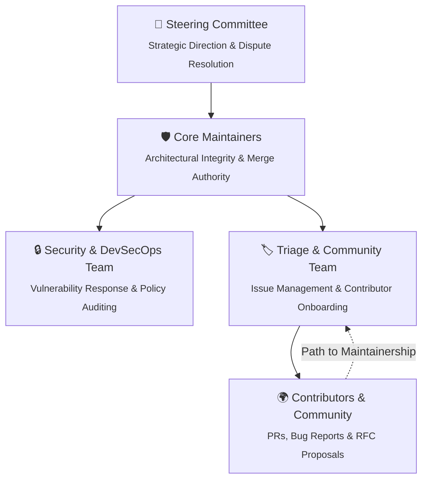

# 🏛️ GLASTOR® Core Governance Model

**Effective Date:** October 2026\
**Status:** Living Document\
**Scope:** All repositories, teams, and contributors under the `glastor-core` organization.

---

## 🌐 1. Overview & Values

**GLASTOR® Core** operates as an engineering-driven, transparent, and security-first ecosystem. Our
governance model is designed to facilitate deterministic technical decision-making, prevent
maintainer burnout, and provide a clear, merit-based path for community contributors to become core
decision-makers.

Our guiding principles:

1. **Architectural Determinism:** Zero-bloat modularity, sub-millisecond execution, and
   least-privilege security.
2. **Open & Asynchronous:** Discussions, proposals, and decisions happen in public (GitHub
   Discussions, RFCs, and Pull Requests).
3. **Continuous Compliance:** Security and hygiene standards are non-negotiable and enforced
   automatically via CI/CD.

---

## 👥 2. Organizational Roles & Responsibilities

### 👑 Steering Committee (`@glastor-core/steering`)

- Sets long-term strategic direction, brand integrity, and licensing compliance.
- Resolves technical deadlocks that cannot reach consensus in the RFC process.
- Manages organizational assets, domains, and security credentials.

### 🛡️ Core Maintainers (`@glastor-core/maintainers`)

- Own architectural integrity and possess merge rights across organizational repositories.
- Review and approve RFCs and mission-critical Pull Requests.
- Ensure all releases adhere to SLSA provenance and cryptographic signing standards.

### 🔒 Security Response Team (`@glastor-core/security`)

- Investigates vulnerabilities submitted through Private Vulnerability Reporting (PVR).
- Enforces supply-chain security, automated secret protection, and dependency hygiene.
- Coordinates CVE assignments and public disclosure under our [Security Policy](SECURITY.md).

### 🏷️ Triage Team (`@glastor-core/triage`)

- Labels, prioritizes, and responds to incoming issues and pull requests.
- Curates `good first issue` and `help wanted` tags for new contributors.
- Moderates GitHub Discussions and community communication channels.

---

## 📜 3. Decision-Making & RFC Process

Technical changes of significant scope must follow our **Request for Comments (RFC)** process:

1. **When is an RFC required?**
   - Introducing a new core module, sub-engine, or API breaking change.
   - Changing dependency policies, runtime requirements, or CI/CD supply-chain pipelines.
   - Significant modifications to governance, security SLAs, or contribution guidelines.

2. **The RFC Lifecycle:**
   - **Draft:** Author submits an RFC PR using the [RFC Template](rfcs/0000-template.md).
   - **Discussion:** Community and maintainers review asynchronously (minimum 7-day review period).
   - **Consensus / Vote:** Approval requires agreement from at least 2 Core Maintainers with zero
     vetoes.
   - **Implementation:** Once accepted, tracking issues are opened and implementation begins.

---

## 🪜 4. Path to Maintainership

We actively foster leadership from within our community:

| Tier                | Prerequisites                                                                         | Capabilities                                                         |
| :------------------ | :------------------------------------------------------------------------------------ | :------------------------------------------------------------------- |
| **Contributor**     | Submitted 1+ merged PR or substantive issue report.                                   | Can participate in reviews and discussions.                          |
| **Triager**         | Consistent quality activity across 30+ days; accurate issue classification.           | Triage permissions: assign labels, milestones, and close duplicates. |
| **Maintainer**      | Deep understanding of system architecture; author of 3+ substantial features or RFCs. | Write and merge access; reviewer status in `CODEOWNERS`.             |
| **Steering Member** | Long-term stewardship, strategic contribution, and peer consensus.                    | Full organization administrative governance.                         |

---

## 🤝 5. Code of Conduct Enforcement

All members must abide by our [Code of Conduct](CODE_OF_CONDUCT.md). Violations are handled
confidentially by the Security & Governance team via
[glastor.info@gmail.com](mailto:glastor.info@gmail.com).

---

© 2026 GLASTOR® Core. Licensed under Apache 2.0.
