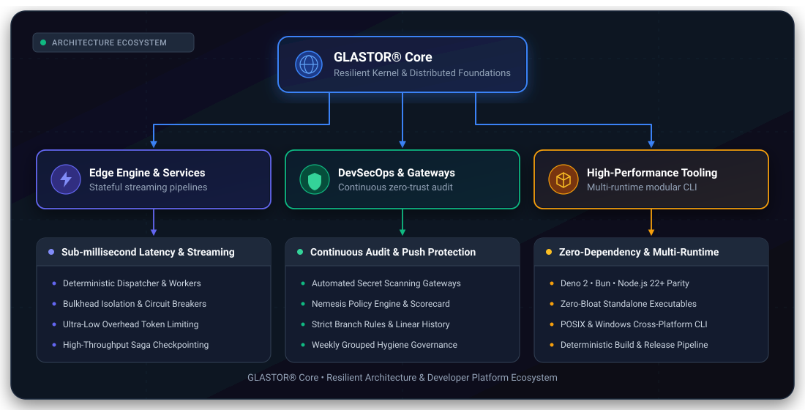

# ⚡ GLASTOR® Core

**Resilient Architecture, High-Performance Systems & Next-Gen Developer Tooling**

  <a href="#-about-glastor-core">About</a> •
  <a href="#-ecosystem">Ecosystem</a> •
  <a href="#-architecture">Architecture</a> •
  <a href="#-governance--security">Governance</a> •
  <a href="#-contributing--community">Community</a> •
  <a href="#-support">Support</a>

---

## 🌐 About GLASTOR® Core

**GLASTOR® Core** is an engineering organization dedicated to crafting resilient, modern foundations
for cloud, edge, and developer platforms. Our systems prioritize deterministic execution, zero-bloat
modularity, sub-millisecond throughput, and continuous security compliance.

  

---

## 🚀 Ecosystem Repositories

| Repository                                                         | Purpose                                                      | Status                                                                                                            | Governance                                                                            |
| :----------------------------------------------------------------- | :----------------------------------------------------------- | :---------------------------------------------------------------------------------------------------------------- | :------------------------------------------------------------------------------------ |
| **[`glastor-core`](https://github.com/glastor-core/glastor-core)** | Core engine runtime, stateful pipelines, and modular kernel  |  | [Core Maintainers](https://github.com/glastor-core/.github/blob/main/CODEOWNERS)      |
| **[`.github`](https://github.com/glastor-core/.github)**           | Organization-wide governance, reusable workflows & standards |       | [Steering Committee](https://github.com/glastor-core/.github/blob/main/GOVERNANCE.md) |
| **[`nemesis`](https://github.com/glastor-core/nemesis)**           | Automated security auditing, policy gatekeeper & scorecards  |            | [Security Team](https://github.com/glastor-core/.github/blob/main/SECURITY.md)        |

---

## 🏛️ Governance & Enterprise Standards

We hold ourselves to rigorous open-source standards:

- **[Governance Model](https://github.com/glastor-core/.github/blob/main/GOVERNANCE.md)**:
  Transparent leadership, consensus-seeking RFC decisions, and clear paths to maintainership.
- **[Public Roadmap](https://github.com/glastor-core/.github/blob/main/ROADMAP.md)**: Track what we
  are building _Now_, _Next_, and _Later_.
- **[RFC Framework](https://github.com/glastor-core/.github/tree/main/rfcs)**: Formal Request for
  Comments process for major architectural designs.
- **[Branch Rulesets](https://github.com/glastor-core/.github/blob/main/GOVERNANCE.md)**: Enforced
  linear history, required reviews, and secret push protection.
- **[Reusable CI/CD](https://github.com/glastor-core/.github/tree/main/.github/workflows)**:
  Centralized pipelines for multi-engine verification (Deno 2, Bun, Node 22+) and SLSA supply-chain
  security.

---

## 🛡️ Security & Disclosure

Security is designed into our inner development loop:

- **Push Protection**: Automated secret scanning blocks leaked credentials before commits reach
  `main`.
- **Private Reporting**: Vulnerabilities are addressed under strict SLA timelines via GitHub
  [Private Vulnerability Reporting](https://github.com/glastor-core/.github/blob/main/SECURITY.md).
- **Dependency Hygiene**: Weekly grouped dependency updates with continuous vulnerability audits.

---

## 🤝 Contributing & Community

We welcome systems engineers, performance architects, and contributors of all backgrounds:

- Read our
  **[Contributing Guidelines](https://github.com/glastor-core/.github/blob/main/CONTRIBUTING.md)**
  and
  **[Commit Convention](https://github.com/glastor-core/.github/blob/main/COMMIT_CONVENTION.md)**.
- Review our
  **[Code of Conduct](https://github.com/glastor-core/.github/blob/main/CODE_OF_CONDUCT.md)**.
- Start or join discussions in
  **[GitHub Discussions](https://github.com/orgs/glastor-core/discussions)**.
- Launch zero-setup development with
  **[GitHub Codespaces](https://github.com/codespaces/new?hide_repo_select=true&ref=main&repo=glastor-core/glastor-core)**.

---

  © 2026 GLASTOR®. Built with rigor, precision, and passion.

