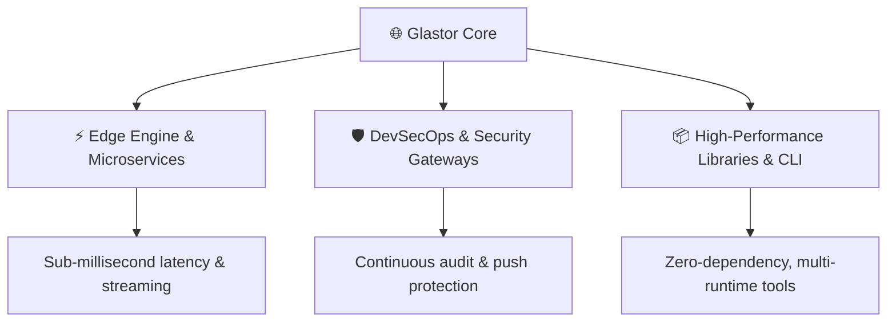

# ⚡ GLASTOR® Core

**Resilient Architecture, High-Performance Systems & Next-Gen Developer Tooling**

  <a href="#-about-glastor-core">About</a> •
  <a href="#-ecosystem">Ecosystem</a> •
  <a href="#-security--governance">Security & Governance</a> •
  <a href="#-contributing">Contributing</a> •
  <a href="#-contact">Contact</a>

---

## 🌐 About GLASTOR® Core

**GLASTOR® Core** is an engineering organization dedicated to crafting resilient, modern foundations for cloud, edge, and developer platforms. Our systems prioritize deterministic execution, zero-bloat modularity, and continuous security compliance.

---

## 🚀 Ecosystem Repositories

| Repository | Purpose | Status |
| :--- | :--- | :--- |
| **[`glastor-core`](https://github.com/glastor-core/glastor-core)** | Core engine runtime, stateful pipelines, and modular kernel |  |
| **[`.github`](https://github.com/glastor-core/.github)** | Organization-wide standards, issue templates, and governance |  |

---

## 🛡️ Security & Governance

Security is not an afterthought; it is built into our core loop:
- **Push Protection**: Automated secret scanning blocks leaked credentials before commits reach `main`.
- **Branch Rulesets**: Strict linear history, required code reviews, and passing CI status checks.
- **Dependency Hygiene**: Automated weekly grouped updates with zero noise.
- **Private Reporting**: Vulnerabilities are handled under strict SLA guidelines via [Security Policy](https://github.com/glastor-core/glastor-core/blob/main/SECURITY.md).

---

## 🤝 Community & Contributing

We welcome passionate developers and system architects:
- Read our [Contributing Guidelines](https://github.com/glastor-core/glastor-core/blob/main/CONTRIBUTING.md) to understand our Conventional Commit standards and workflow.
- Review our [Code of Conduct](https://github.com/glastor-core/glastor-core/blob/main/CODE_OF_CONDUCT.md).
- Start a conversation in [Discussions](https://github.com/orgs/glastor-core/discussions).

---

  © 2026 GLASTOR®. Built with rigor, precision, and passion.

