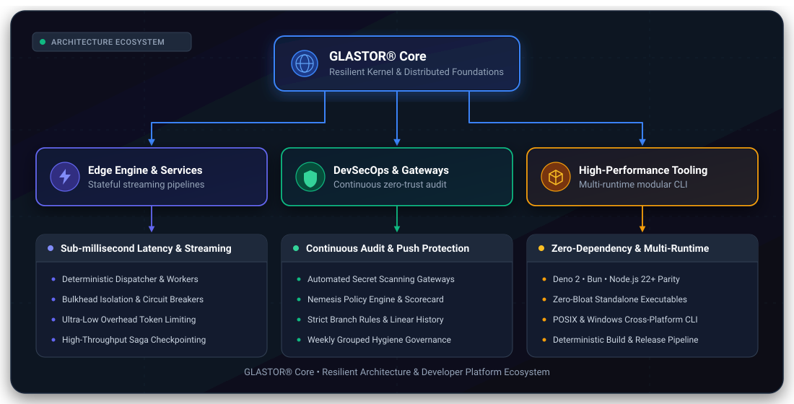

# ⚡ GLASTOR® Core

**Resilient Architecture, High-Performance Systems & Next-Gen Developer Tooling**

  <a href="#-about-glastor-core">About</a> •
  <a href="#-ecosystem">Ecosystem</a> •
  <a href="#-architecture">Architecture</a> •
  <a href="#-governance--security">Governance</a> •
  <a href="#-contributing--community">Community</a> •
  <a href="#-support">Support</a>

---

## 🌐 About GLASTOR® Core

**GLASTOR® Core** is an engineering organization dedicated to crafting resilient, modern foundations
for cloud, edge, and developer platforms. Our systems prioritize deterministic execution, zero-bloat
modularity, sub-millisecond throughput, and continuous security compliance.

  

---

## 🚀 Ecosystem Repositories

| Repository                                                         | Purpose                                                                      | Status                                                                                                              | Governance                                                                            |
| :----------------------------------------------------------------- | :--------------------------------------------------------------------------- | :------------------------------------------------------------------------------------------------------------------ | :------------------------------------------------------------------------------------ |
| **[`glastor-core`](https://github.com/glastor-core/glastor-core)** | Core engine runtime, stateful pipelines, and modular kernel                  |    | [Core Maintainers](https://github.com/glastor-core/.github/blob/main/CODEOWNERS)      |
| **[`nemesis`](https://github.com/glastor-core/nemesis)**           | Automated DevSecOps auditing, repo hygiene, auto-fix & compliance CLI/Action |              | [Security Team](https://github.com/glastor-core/.github/blob/main/SECURITY.md)        |
| **[`zerho`](https://github.com/glastor-core/zerho)**               | High-performance documentation engine for Deno 2 & Edge with `llms.txt`      |  | [Core Maintainers](https://github.com/glastor-core/.github/blob/main/CODEOWNERS)      |
| **[`medusa`](https://github.com/glastor-core/medusa)**             | Resilient Edge API Gateway & Caching Proxy with Circuit Breaker & Deno KV    |        | [Core Maintainers](https://github.com/glastor-core/.github/blob/main/CODEOWNERS)      |
| **[`hyper-flow`](https://github.com/glastor-core/hyper-flow)**     | Ultra-high-throughput Edge AI API built with Hono, Bun & OpenAPI 3.1         |  | [Core Maintainers](https://github.com/glastor-core/.github/blob/main/CODEOWNERS)      |
| **[`.github`](https://github.com/glastor-core/.github)**           | Organization-wide governance, reusable workflows & engineering standards     |         | [Steering Committee](https://github.com/glastor-core/.github/blob/main/GOVERNANCE.md) |

---

## 🏛️ Governance & Enterprise Standards

We hold ourselves to rigorous open-source standards:

- **[Engineering Leadership (@glastor-dev)](https://github.com/glastor-dev)**: Founded and
  architected by a verified **GitHub Developer Program Member**, building enterprise-grade GitHub
  ecosystem integrations, automated security tooling, and high-throughput runtimes under
  **[glastor.es](https://glastor.es)** ([`ventas@glastor.es`](mailto:ventas@glastor.es)).
- **[Governance Model](https://github.com/glastor-core/.github/blob/main/GOVERNANCE.md)**:
  Transparent leadership, consensus-seeking RFC decisions, and clear paths to maintainership.
- **[Public Roadmap](https://github.com/glastor-core/.github/blob/main/ROADMAP.md)**: Track what we
  are building _Now_, _Next_, and _Later_.
- **[RFC Framework](https://github.com/glastor-core/.github/tree/main/rfcs)**: Formal Request for
  Comments process for major architectural designs.
- **[Branch Rulesets](https://github.com/glastor-core/.github/blob/main/GOVERNANCE.md)**: Enforced
  linear history, required reviews, and secret push protection.
- **[Reusable CI/CD](https://github.com/glastor-core/.github/tree/main/.github/workflows)**:
  Centralized pipelines for multi-engine verification (Deno 2, Bun, Node 22+) and SLSA supply-chain
  security.

---

## 🛡️ Security & Disclosure

Security is designed into our inner development loop:

- **Push Protection**: Automated secret scanning blocks leaked credentials before commits reach
  `main`.
- **Private Reporting**: Vulnerabilities are addressed under strict SLA timelines via GitHub
  [Private Vulnerability Reporting](https://github.com/glastor-core/.github/blob/main/SECURITY.md).
- **Dependency Hygiene**: Weekly grouped dependency updates with continuous vulnerability audits.

---

## 🤝 Contributing & Community

We welcome systems engineers, performance architects, and contributors of all backgrounds:

- Read our
  **[Contributing Guidelines](https://github.com/glastor-core/.github/blob/main/CONTRIBUTING.md)**
  and
  **[Commit Convention](https://github.com/glastor-core/.github/blob/main/COMMIT_CONVENTION.md)**.
- Review our
  **[Code of Conduct](https://github.com/glastor-core/.github/blob/main/CODE_OF_CONDUCT.md)**.
- Start or join discussions in
  **[GitHub Discussions](https://github.com/orgs/glastor-core/discussions)**.
- Launch zero-setup development with
  **[GitHub Codespaces](https://github.com/codespaces/new?hide_repo_select=true&ref=main&repo=glastor-core/glastor-core)**.

---

  © 2026 <a href="https://glastor.es">GLASTOR®</a> • Led by <a href="https://github.com/glastor-dev">@glastor-dev</a> (GitHub Developer Program Member). Built with rigor, precision, and passion.

