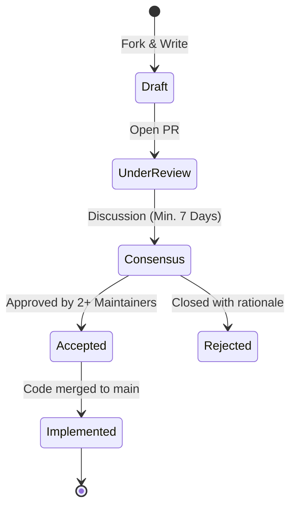

# 📋 GLASTOR® Core RFC Process

The **Request for Comments (RFC)** process is how major architectural, technical, and governance
changes are proposed, reviewed, and adopted across the **GLASTOR® Core** ecosystem.

---

## 🔄 Lifecycle of an RFC



1. **Draft:** Copy [`0000-template.md`](0000-template.md) to `text/0000-your-proposal-name.md`.
2. **Pull Request:** Open a PR titled `RFC: Your Proposal Title` against `.github`.
3. **Review & Iterate:** Maintainers and community members review asynchronously.
4. **Final Decision:** A minimum of 7 calendar days must elapse before an RFC is merged or closed.

---

## 📁 Repository Structure

```text
rfcs/
├── README.md               # Process explanation (this document)
├── 0000-template.md        # Official template for new proposals
└── text/                   # Accepted RFCs sequentially numbered
```
