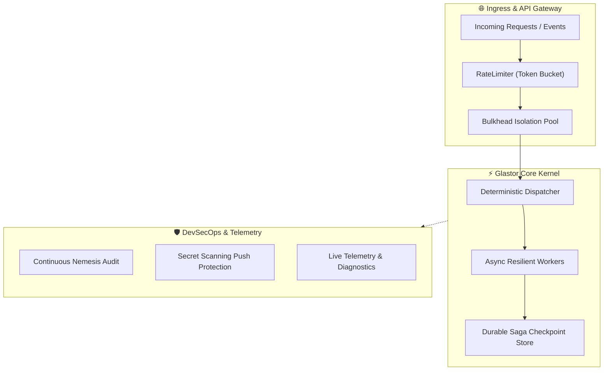

<div align="center">

# ⚡ GLASTOR® Core

**The resilient, high-throughput core engine powering next-generation distributed systems.**

[](LICENSE)
[](#)
[](https://github.com/glastor-core/glastor-core/actions/workflows/scorecard.yml)
[](SECURITY.md)
[](https://github.com/glastor-dev/nemesis)
[](https://github.com/orgs/glastor-core/discussions)
[](llms.txt)

<p align="center">
  <a href="#-features">Features</a> •
  <a href="#-architecture">Architecture</a> •
  <a href="#-quick-start">Quick Start</a> •
  <a href="#-project-structure">Structure</a> •
  <a href="#-contributing">Contributing</a> •
  <a href="#-discussions--support">Discussions</a> •
  <a href="#-license">License</a>
</p>

---

</div>

## 🌟 Key Highlights

- **⚡ Blazing Throughput**: Designed for sub-millisecond execution and low memory footprint.
- **🛡️ Built-in Resilience**: Circuit breaker patterns, bulkhead isolation, and rate-limiting
  primitives.
- **🔒 Zero-Trust Security**: Proactive secret scanning, least-privilege token permissions, and
  automated hygiene audits.
- **📦 Multi-Runtime Ready**: Engineered with compatibility for modern engines (Deno 2, Bun,
  Node.js).
- **🤖 DevSecOps First**: Strict CI/CD pipelines, automated PR triaging, and grouped dependency
  governance.

---

## 🏛️ Architecture Overview



---

## 🚀 Quick Start

### Prerequisites

- Modern runtime: [Deno 2](https://deno.com/), [Bun](https://bun.sh/), or
  [Node.js 22+](https://nodejs.org/)
- Git 2.40+

### Installation & Local Setup

```bash
# Clone the repository
git clone https://github.com/glastor-core/glastor-core.git
cd glastor-core

# Verify environment formatting and hygiene
deno fmt --check || npm run lint
```

---

## 📂 Project Structure

```text
glastor-core/
├── .github/
│   ├── ISSUE_TEMPLATE/       # Structured GitHub forms for issues & features
│   ├── profile/              # Organization-wide showcase README
│   ├── workflows/            # High-velocity CI/CD, DevSecOps, & Auto-release
│   ├── CODEOWNERS            # Automated PR review routing
│   ├── FUNDING.yml           # Sponsorship and community funding channels
│   ├── dependabot.yml        # Noise-free weekly grouped dependency updates
│   ├── labeler.yml           # Automated PR path-based labeling rules
│   └── PULL_REQUEST_TEMPLATE.md
├── .editorconfig             # Standardized cross-editor code styling
├── .gitattributes            # Deterministic LF line-ending normalization
├── .gitignore                # Enterprise-grade secret and artifact exclusion
├── CITATION.cff              # Citation metadata for academic and industrial attribution
├── CODE_OF_CONDUCT.md        # Contributor Covenant v2.1
├── CONTRIBUTING.md           # Conventional Commits, Git Flow, and PR guidelines
├── LICENSE                   # Apache 2.0 Open Source License
├── README.md                 # Project entry point and documentation
├── SECURITY.md               # Responsible vulnerability disclosure policy
└── SUPPORT.md                # Community channels, discussions, and enterprise support
```

---

## 🔒 Security & Governance

We maintain strict zero-trust standards:

- **Push Protection**: Activated via GitHub repository security settings.
- **Branch Rules**: Direct pushes to `main` are disabled; all merges require peer review and green
  CI checks.
- **Vulnerability Reporting**: See [SECURITY.md](SECURITY.md) for encrypted reporting procedures.

---

## 💬 Discussions & Support

Need assistance or have an architectural idea?

- Join the community in [GitHub Discussions](https://github.com/orgs/glastor-core/discussions).
- Review our [Support Guidelines](SUPPORT.md) for enterprise and SLA details.

---

## 🤝 Contributing

We welcome contributions! Please consult the [Contributing Guide](CONTRIBUTING.md) to learn about
our branch standards, commit formatting (`feat:`, `fix:`, etc.), and test coverage expectations.

---

## 📜 Citation

If you use **GLASTOR® Core** in your research or production systems, please cite it using
[`CITATION.cff`](CITATION.cff).

---

## 📄 License

Distributed under the **Apache License 2.0**. See [`LICENSE`](LICENSE) for full details.

<div align="center">
  <sub>© 2026 GLASTOR®. Built with rigor, precision, and passion.</sub>
</div>
