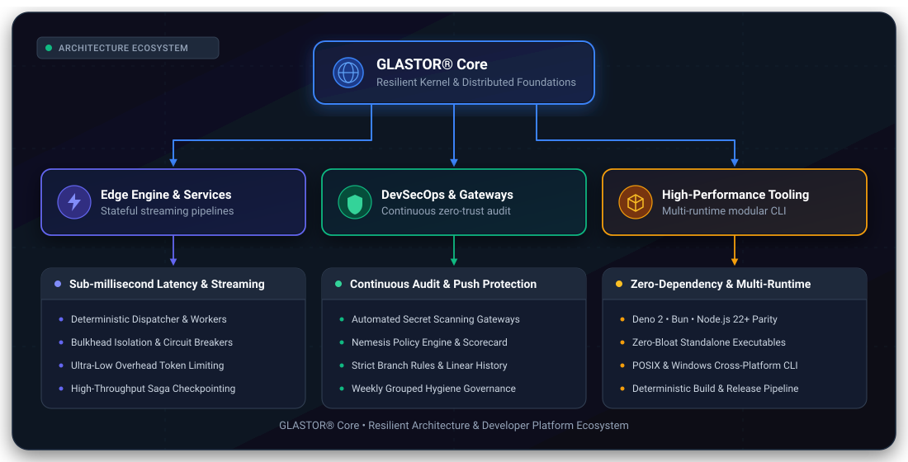

<div align="center">

# ⚡ GLASTOR® Core

**The resilient, high-throughput core engine powering next-generation distributed systems.**

[](LICENSE)
[](https://github.com/glastor-dev)
[](https://github.com/glastor-core/glastor-core/actions/workflows/ci.yml)
[](https://github.com/glastor-core/glastor-core/actions/workflows/scorecard.yml)
[](SECURITY.md)
[](https://github.com/glastor-core/nemesis)
[](https://github.com/glastor-core/vortex)
[](https://github.com/glastor-core/specter)
[](https://github.com/glastor-core/byte-gauge)
[](https://github.com/orgs/glastor-core/discussions)
[](llms.txt)
[](https://glastor.es)

<p align="center">
  <a href="#features">Features</a> •
  <a href="#ecosystem">Ecosystem</a> •
  <a href="#architecture">Architecture</a> •
  <a href="#quick-start">Quick Start</a> •
  <a href="#structure">Structure</a> •
  <a href="#security">Security</a> •
  <a href="#contributing">Contributing</a> •
  <a href="#discussions">Discussions</a> •
  <a href="#license">License</a>
</p>

---

</div>

<a id="features"></a>

## 🌟 Key Features & Highlights

- **⚡ Blazing Throughput**: Designed for sub-millisecond execution and low memory footprint.
- **🛡️ Built-in Resilience**: Circuit breaker patterns, bulkhead isolation, and rate-limiting
  primitives.
- **🔒 Zero-Trust Security**: Proactive secret scanning, least-privilege token permissions, and
  automated hygiene audits.
- **📦 Multi-Runtime Ready**: Engineered with compatibility for modern engines (Deno 2, Bun,
  Node.js).
- **🤖 DevSecOps First**: Strict CI/CD pipelines, automated PR triaging, and grouped dependency
  governance.

---

<a id="ecosystem"></a>

## 🚀 Ecosystem Repositories

| Repository                                                         | Purpose                                                                           | Key Benchmark / SLA                              | Status                                                                                                                        | Governance                                                                            |
| :----------------------------------------------------------------- | :-------------------------------------------------------------------------------- | :----------------------------------------------- | :---------------------------------------------------------------------------------------------------------------------------- | :------------------------------------------------------------------------------------ |
| **[`glastor-core`](https://github.com/glastor-core/glastor-core)** | Core engine runtime, stateful pipelines, and modular kernel                       | `< 0.5ms` pipeline dispatch · Zero-bloat kernel  | [](https://github.com/glastor-core/glastor-core)             | [Core Maintainers](https://github.com/glastor-core/.github/blob/main/CODEOWNERS)      |
| **[`nemesis`](https://github.com/glastor-core/nemesis)**           | Automated DevSecOps auditing, repo hygiene, auto-fix & compliance CLI/Action      | `< 5s` full repo audit · Zero-config auto-fix    | [](https://github.com/glastor-core/nemesis)                       | [Security Team](https://github.com/glastor-core/.github/blob/main/SECURITY.md)        |
| **[`vortex`](https://github.com/glastor-core/vortex)**             | AST-driven predictive CI orchestrator, barrel pruner, LPT splitter & FinOps       | `~60%` CI runtime & Actions FinOps reduction     | [](https://github.com/glastor-core/vortex)          | [Core Maintainers](https://github.com/glastor-core/.github/blob/main/CODEOWNERS)      |
| **[`specter`](https://github.com/glastor-core/specter)**           | Zero-Compiler Polyglot AST API Contract Differ, Trojan Guard & SemVer Gatekeeper  | `< 12ms` polyglot AST diff · SARIF 2.1.0 & SBOM  | [](https://github.com/glastor-core/specter)     | [Security Team](https://github.com/glastor-core/.github/blob/main/SECURITY.md)        |
| **[`byte-gauge`](https://github.com/glastor-core/byte-gauge)**     | Rust SIMD Binary & Wasm Auditor, `checksec` Hardening, CycloneDX 1.5 SBOM & SARIF | `< 8ms` SIMD ELF/PE/Mach-O/Wasm hardening audit  | [](https://github.com/glastor-core/byte-gauge) | [Security Team](https://github.com/glastor-core/.github/blob/main/SECURITY.md)        |
| **[`zerho`](https://github.com/glastor-core/zerho)**               | High-performance documentation engine for Deno 2 & Edge with `llms.txt`           | `< 15ms` Edge TTFB · Native `llms.txt` index     | [](https://github.com/glastor-core/zerho)           | [Core Maintainers](https://github.com/glastor-core/.github/blob/main/CODEOWNERS)      |
| **[`medusa`](https://github.com/glastor-core/medusa)**             | Resilient Edge API Gateway & Caching Proxy with Circuit Breaker & Deno KV         | `< 1.8ms` proxy overhead · Single-Flight KV      | [](https://github.com/glastor-core/medusa)                 | [Core Maintainers](https://github.com/glastor-core/.github/blob/main/CODEOWNERS)      |
| **[`hyper-flow`](https://github.com/glastor-core/hyper-flow)**     | Ultra-high-throughput Edge AI API built with Hono, Bun & OpenAPI 3.1              | `10K+ req/s` Edge AI routing · OpenAPI 3.1       | [](https://github.com/glastor-core/hyper-flow)           | [Core Maintainers](https://github.com/glastor-core/.github/blob/main/CODEOWNERS)      |
| **[`.github`](https://github.com/glastor-core/.github)**           | Organization-wide governance, reusable workflows & engineering standards          | `100%` SLSA provenance & branch ruleset coverage | [](https://github.com/glastor-core/.github)                  | [Steering Committee](https://github.com/glastor-core/.github/blob/main/GOVERNANCE.md) |
| **[`glastor-dev`](https://github.com/glastor-dev/glastor-dev)**    | Autonomous Living Profile & AST README Engine (`@glastor-dev/readmegen`)          | `0-WASM` TS AST parser · 4R Code Review Engine   | [](https://jsr.io/@glastor-dev/readmegen)                                 | [Lead Architect (@glastor-dev)](https://github.com/glastor-dev)                       |

---

<a id="architecture"></a>

## 🏛️ Architecture Overview

<p align="center">
  
</p>

---

<a id="quick-start"></a>

## 🚀 Quick Start

### Prerequisites

- Modern runtime: [Deno 2](https://deno.com/), [Bun](https://bun.sh/), or
  [Node.js 22+](https://nodejs.org/)
- Git 2.40+

### Installation & Local Setup

```bash
# Clone the repository
git clone https://github.com/glastor-core/glastor-core.git
cd glastor-core

# Verify environment formatting and hygiene
deno fmt --check || npm run lint
```

---

<a id="structure"></a>

## 📂 Project Structure

```text
glastor-core/
├── .devcontainer/            # Zero-setup GitHub Codespaces environment
├── .github/
│   ├── ISSUE_TEMPLATE/       # Structured GitHub forms for issues & features
│   ├── profile/              # Organization-wide showcase README & vector assets
│   ├── rfcs/                 # Request for Comments architectural proposal framework
│   ├── workflows/            # High-velocity CI/CD, DevSecOps, & reusable pipelines
│   ├── CODEOWNERS            # Automated PR review routing by team
│   ├── FUNDING.yml           # Sponsorship and community funding channels
│   ├── GOVERNANCE.md         # Transparent leadership & maintainership model
│   ├── ROADMAP.md            # Public architecture roadmap (Now / Next / Later)
│   ├── dependabot.yml        # Noise-free weekly grouped dependency updates
│   ├── labeler.yml           # Automated PR path-based labeling rules
│   └── PULL_REQUEST_TEMPLATE.md
├── assets/                   # Architecture diagrams and visual ecosystem assets
├── src/                      # Core runtime engine implementation
├── tests/                    # Deterministic test suites
├── .editorconfig             # Standardized cross-editor code styling
├── .gitattributes            # Deterministic LF line-ending normalization
├── .gitignore                # Enterprise-grade secret and artifact exclusion
├── CITATION.cff              # Citation metadata for academic and industrial attribution
├── CODE_OF_CONDUCT.md        # Contributor Covenant v2.1
├── CONTRIBUTING.md           # Conventional Commits, Git Flow, and PR guidelines
├── LICENSE                   # Apache 2.0 Open Source License
├── README.md                 # Project entry point and documentation
├── SECURITY.md               # Responsible vulnerability disclosure policy
└── SUPPORT.md                # Community channels, discussions, and enterprise support
```

---

<a id="security"></a>

## 🔒 Security & Governance

We maintain strict zero-trust standards:

- **Push Protection**: Automated secret scanning blocks leaked credentials before commits reach
  `main`.
- **Branch Rules**: Direct pushes to `main` are disabled; all merges require peer review and green
  CI checks.
- **Vulnerability Reporting**: See [SECURITY.md](SECURITY.md) for confidential advisory reporting
  procedures.
- **Engineering Leadership**: Directed by [@glastor-dev](https://github.com/glastor-dev) (**GitHub
  Developer Program Member**) under the official [glastor.es](https://glastor.es) engineering
  division.
- **Organization Governance**: Consult [GOVERNANCE.md](.github/GOVERNANCE.md) for leadership
  structure, team roles, and RFC adoption rules.
- **Community Standards**: Enforced across all community interactions via
  [CODE_OF_CONDUCT.md](CODE_OF_CONDUCT.md).

---

<a id="discussions"></a>

## 💬 Discussions & Support

Need assistance or have an architectural idea?

- Join the community in [GitHub Discussions](https://github.com/orgs/glastor-core/discussions).
- Review our [Support Guidelines](SUPPORT.md) for community channels and SLA details.
- For enterprise & commercial inquiries: [`ventas@glastor.es`](mailto:ventas@glastor.es) •
  [glastor.es](https://glastor.es).

---

<a id="contributing"></a>

## 🤝 Contributing

We welcome contributions! Please consult the [Contributing Guide](CONTRIBUTING.md) to learn about
our branch standards, commit formatting (`feat:`, `fix:`, etc.), and test coverage expectations.
Check our [Public Roadmap](.github/ROADMAP.md) for active milestones.

---

<a id="citation"></a>

## 📜 Citation

If you use **GLASTOR® Core** in your research or production systems, please cite it using
[`CITATION.cff`](CITATION.cff).

---

<a id="license"></a>

## 📄 License

Distributed under the **Apache License 2.0**. See [`LICENSE`](LICENSE) for full details.

<div align="center">
  <sub>© 2026 <a href="https://glastor.es">GLASTOR®</a> • Led by <a href="https://github.com/glastor-dev">@glastor-dev</a> (GitHub Developer Program Member). Built with rigor, precision, and passion.</sub>
</div>
